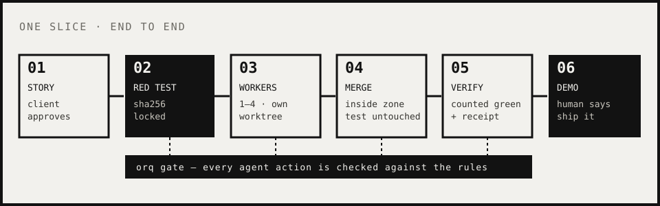

<div align="center">


# CTHULHU HARNESS

**Agents write the code. A program decides when it's done.**

`orq` — a multi-agent coding harness in Go, standard library only.<br>
The in-house dev tool of **[AI EDGE RUNNERS](https://ai-edgerunners-landing.vercel.app)**.

**[Quickstart →](docs/QUICKSTART.md)**

</div>

---

## The problem

Put five coding agents on one product and they get fast — and lose the plot. Each one optimizes its own task;
nobody remembers why the product exists. They edit the test that was supposed to judge them, declare victory on
zero tests run, spawn helpers you never see, leave 80 GB of worktrees behind, and die with their context.
A human ends up babysitting every pane.

## The promise

- **Product focus.** Every unit of work (a *slice*) starts from one approved user story and a **red acceptance test**.
- **Program-enforced done.** Agents cannot edit the exam, cannot merge, cannot close. `orq` re-runs the untouched exam, counts the tests, writes a receipt.
- **No babysitting.** One board for the Owner, explicit stoppers when a human is really needed, everything else autonomous within limits.
- **Survives death.** Any role can be closed and revived from memory and a handoff note.

> What must always be the same is enforced by a program, not by a prompt.

<div align="center">


</div>

## The method: TCADD

| | Phase | What happens |
|---|---|---|
| **T** | Translation | Atena interviews the Owner; an idea becomes a story with business value, classified (greenfield/brownfield, stage, criticality) |
| **C** | Context | Read-only scouts check the story against the real repo and data |
| **A** | Analysis | The smallest plan plus the failing acceptance test; an adversary from another model family pushes back |
| **D** | Development | Workers turn the test green in parallel, isolated in worktrees, watched by the gate |
| **D** | Documentation | Receipt, memory and handoff land with the slice, so the next agent starts where this one ended |

Rigor is proportional to risk: criticality decides whether QA layers (unit, adversarial, mutation) are required.



## Roles

| Role | Does | Never |
|---|---|---|
| **Atena** | The Owner's only interface; owns phase T; filters what reaches the team; resolves stoppers | Writes code |
| **Orchestrator** | Opens sessions, launches workers from the plan, merges, verifies, closes | Plans or writes code |
| **Planner** | Turns one approved story into a minimal plan + red acceptance test; keeps it current | Implements |
| **Adversary (Astra)** | Argues the plan down for value and speed until both agree | Implements |
| **Scouts** | Read-only exploration of repo, docs and data | Write anything |
| **Workers** | Make the exam green inside their worktree and zone | Touch the exam, push, spawn agents, close |
| **Tester / repairer** | Independent QA (`orq qa run`), findings with repro; repairs bounded to 2 attempts | Tester writes no code |
| **Verifier** | Fresh-context check of the receipt against the story | Trusts the worker's word |

`orq skill ROLE` prints each role's guide and the skills it should load.

## What the program enforces vs what is advice

**Enforced by `orq` (code, tests, exit codes):**

| Guard | Rule |
|---|---|
| Honest red | `slice open` refuses unless the exam fails **by assertion**; the test bundle is fingerprinted (sha256) |
| Honest green | `slice verify` re-runs the untouched exam; 0 tests executed ≠ green; skipped tests fail unless allowed; a receipt is written |
| Protected exam | The gate blocks edits through Edit/Write, redirects, `sed -i`, `cp`, `mv`, `rm`, `git checkout`; the diff against the red commit must be empty anyway |
| One writer | `slice take` — one writer per slice; changing exam or scope needs recorded approval |
| Destructive git | `push`, `--force`, `branch -D`, `reset --hard`, forced worktree removal are blocked for agents |
| Resources | Admission checks disk, HALT, worker and worktree caps before any launch; `orq gc` never forces |
| Failure | Two failed repairs or no progress → **BLOCKED**; max 3 attempts |
| QA by criticality | Medium+ cannot close without a QA receipt |
| Resumable close | `slice close` integrates exactly once even if killed mid-way |

**Advice (prompts and skills, not guaranteed):** product judgment, plan quality, code style, when to raise a
stopper, how to split tasks, how much to test beyond the exam.

## Platform-free

- **Agents and models per role** live in `orq.agents.json` (`orq config agents show|detect|set ROLE AGENT:MODEL`).
  Claude, Codex, Gemini or any CLI with a headless mode; cheap models for cheap work, worker model by risk.
- **Runners:** `herdr` (panes), `tmux`, or `process` (plain background process, no UI).
- **Gate:** reads the PreToolUse hook JSON on stdin (`orq gate`, exit 2 = block); fail-closed if `orq` is missing.
- English CLI; Spanish aliases (`abrir`, `verificar`, `cerrar`) and `ORQ_LANG=es` for Spanish messages.

## Board, stoppers, autonomy

- `orq board [--json|--html]` — one view for the Owner: open stoppers first, then slices with % done, workers, velocity.
- `orq stop raise --type credential|api_key|decision|confirmation|access --severity blocking|soon|fyi` — a request
  to the Owner. Secrets never go in text: the stopper says *where* to put them. Only Atena/Owner resolve.
- `orq autonomy guided|free --scope ...` — free mode must be approved by the Owner.
- `orq worker beat|done|list` — live worker state in `.orq/workers/<id>/state.json`.

## Memory and handoff

- `orq mem add --imp I --cat C "≤200 chars"` — atomic, capped memory; `orq mem compact` keeps it small.
- `orq handoff-note ROLE` — a note so a fresh session of that role continues the same work in the same worktree.
- `orq handoff` — `HANDOFF.md` so another *person* can pick up the project. `orq revive` — deterministic context.
- **Sync policy** (`orq init --sync=`): `local` (state stays in `.orq/`, ignored), `commit` (state committed with
  the project), `branch` (state on an `orq/state` branch via `orq sync push|pull`).

## Skills: routing and gallery

Skills are loaded **per phase and role**, not all at once. A catalog (`.orq/skills.catalog.json`) maps each
skill to phases, roles, project types, stacks and minimum criticality. `orq skills plan --phase X --role R`
picks the set; `orq skills vet ID` statically rejects skills that push, force, `rm -rf` or spawn agents;
`orq skills install` pins content hashes in `.orq/skills.lock.json`. Details: [`docs/v2/SKILLS.md`](docs/v2/SKILLS.md).

## Fronts

A big slice can be split into up to 3 fronts (`max_fronts` in limits.json): sub-orchestrators kept as data in the
plan, not new processes. Each front has a product goal, its own non-overlapping paths and an owner role; every task
names its front. `orq front brief F` gives a one-page brief, `orq front receipt F` one page of results (tasks done,
tests, open findings, stoppers), and the board groups tasks by front. Admission stays global, and the main
orchestrator only reads briefs and receipts. Criticality has one source: `orq profile set criticality=…`.

## Verified vs not yet verified

Honest status of v2 (`harness/v2` branch):

**Verified (automated, in this repo):**
- `go vet` + `go test ./...` for the harness.
- `validacion/e2e-v05.sh`: red→trap→retry→green with receipt, stale-attempt closing rejected, handoff without
  duplicate worktrees, a real kill at each closing stage and recovery, two parallel slices closing at once, gate rules, QA receipt.
- `validacion/quickstart.sh`: the [Quickstart](docs/QUICKSTART.md) end to end, hermetic, with a fake agent.
- v1's `validacion/validar-mvp.sh --real` ran one real headless Claude worker that was told to cheat (2/2 blocked).

**Not yet verified:**
- No real **herdr**, **Claude** or **Codex** end-to-end run of v2 (launch → work → verify → close) yet; the
  `herdr`/`tmux` runners are tested with fakes only.
- Worker **exit_code** capture is missing: a `process` worker that dies is noticed by heartbeat/state, not by its exit code.
- Codex has no PreToolUse hook equivalent, so its tool calls do not pass through the gate.

## Install

Requires Go 1.25+ and git.

```bash
make test          # go vet + go test ./...
make install       # builds ~/bin/orq and writes default limits to ~/.config/orq/limits.json
orq watch          # first disk measurement
orq status         # limits, measurements, HALT, workers
```

Then follow the **[Quickstart](docs/QUICKSTART.md)**. Every limit lives in `~/.config/orq/limits.json`
(template: [`templates/limits.json`](templates/limits.json)); the rulebook (Spanish): [`docs/REGLAS-HARNESS.md`](docs/REGLAS-HARNESS.md).

## Layout

```text
harness/      orq — Go, standard library only
skills/       role skills: atena, orchestrator, planner, board, stopper, supervisor
templates/    story.md, limits.json, orq.agents.json, the Claude Code hook
validacion/   e2e suite, quickstart, the cheating test
docs/         QUICKSTART, rulebook, v2 recap/roadmap/specs
assets/       the octopuses
```

---

<div align="center">

Made by the **AI EDGE RUNNERS** team — an applied-AI lab that builds software with agents and keeps a human in charge.

<sub>The octopuses are original AI EDGE RUNNERS characters, drawn as pixel art. The Dreamer is our take on Cthulhu (H. P. Lovecraft, 1928).</sub>

</div>
